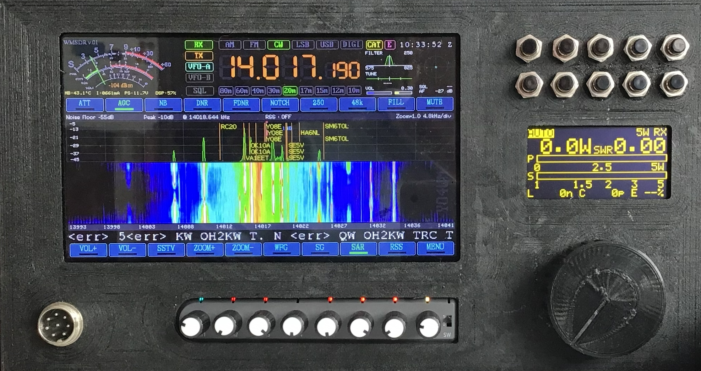

# BEESDR (dependent panadapter)

**🇫🇷 Un panadapter, récepteur DSP et tête de commande pour petits transceivers QRP.**
Le BEESDR améliore le poste que vous possédez déjà — il ne le remplace pas.

**🇬🇧 A panadapter, DSP receiver and control head for small QRP transceivers.**
BEESDR enhances the rig you already own — it does not replace it.

---

## Manuels · Manuals

| | Lire en ligne · Read online | PDF |
|---|---|---|
| 🇫🇷 Français | [Manuel d'utilisation](BEESDR-Manuel-Utilisateur-FR.md) | [BEESDR-Manuel-Utilisateur-FR.pdf](pdf/BEESDR-Manuel-Utilisateur-FR.pdf) |
| 🇬🇧 English | [User Manual](BEESDR-User-Manual-EN.md) | [BEESDR-User-Manual-EN.pdf](pdf/BEESDR-User-Manual-EN.pdf) |

---

## En bref · At a glance

| 🇫🇷 | 🇬🇧 |
|---|---|
| Spectre et cascade, accord en touchant un signal | Spectrum and waterfall, tap a signal to tune |
| DSP : réduction de bruit, notch, noise blanker, AGC, égaliseur | DSP: noise reduction, notch, noise blanker, AGC, equaliser |
| Décodeurs : CW, RTTY, PSK31/63, FT8, SSTV, WeFax | Decoders: CW, RTTY, PSK31/63, FT8, SSTV, WeFax |
| Pages web compagnon : images, FT8, émission CW depuis le navigateur | Companion web pages: pictures, FT8, CW transmit from the browser |
| Émission phonie avec processeur de modulation, manipulateur iambique à palettes | Voice transmit with speech processor, iambic paddle keyer |
| Mode Zeus : radio OpenHPSDR en Wi-Fi pour Zeus, Thetis, piHPSDR | Zeus mode: OpenHPSDR radio over Wi-Fi for Zeus, Thetis, piHPSDR |
| S-mètre calibré, contrôle CAT, huit boutons configurables | Calibrated S-meter, CAT control, eight assignable knobs |
| Poste de référence : uSDX triband (WB2CBA) | Reference rig: uSDX triband (WB2CBA) |
| L'image ci-dessus illustre un cas d'utilisation possible | The image above depicts a possible use case |

---

## Équipe · Team

| | 🇫🇷 | 🇬🇧 |
|---|---|---|
| Gabi Mihaila, **YO4WM** | conception et développement | design and development |
| Vladimir Stephan, **F4FNA** | co-conception, composants, contact en France | co-design, components, contact in France |

---

## Licence · License

© 2026 Gabi Mihaila, YO4WM. Documentation and images licensed under
[CC BY-NC 4.0](https://creativecommons.org/licenses/by-nc/4.0/) — see [LICENSE.md](LICENSE.md).
Partage et adaptation autorisés avec attribution, usage non commercial.
Share and adapt with attribution, non-commercial use only.
